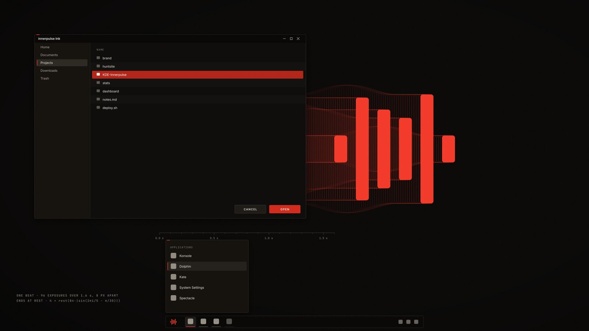
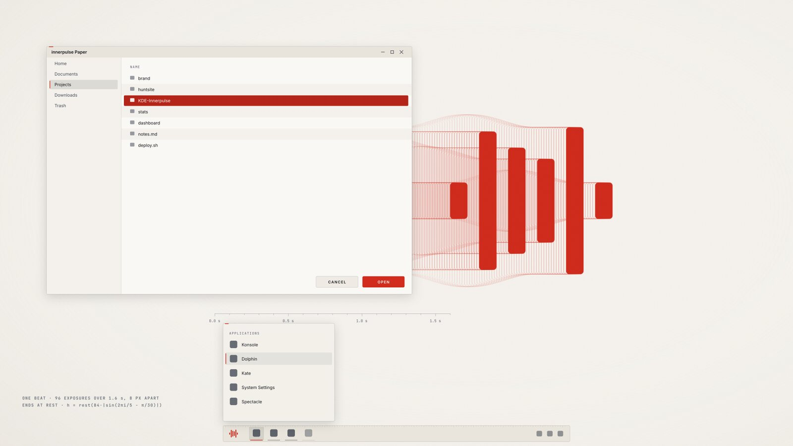
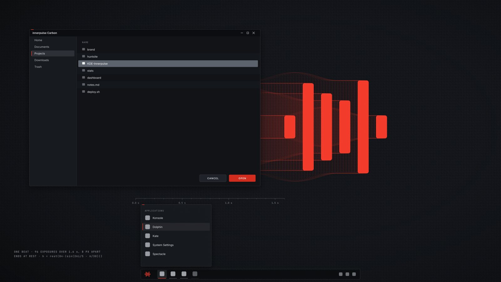
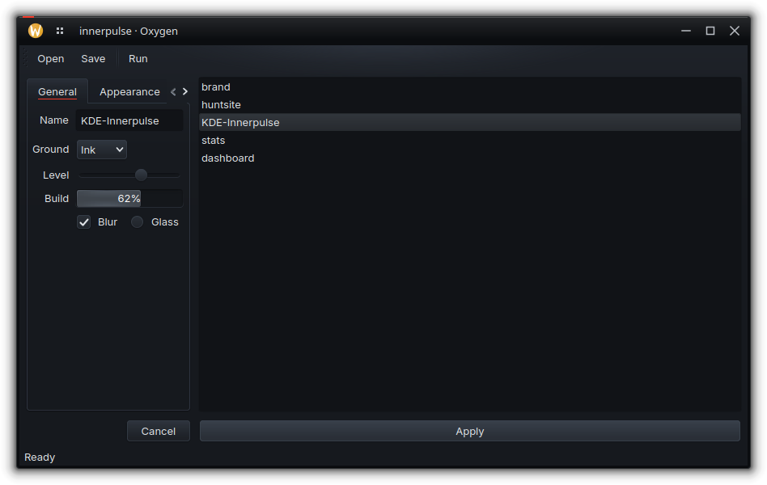
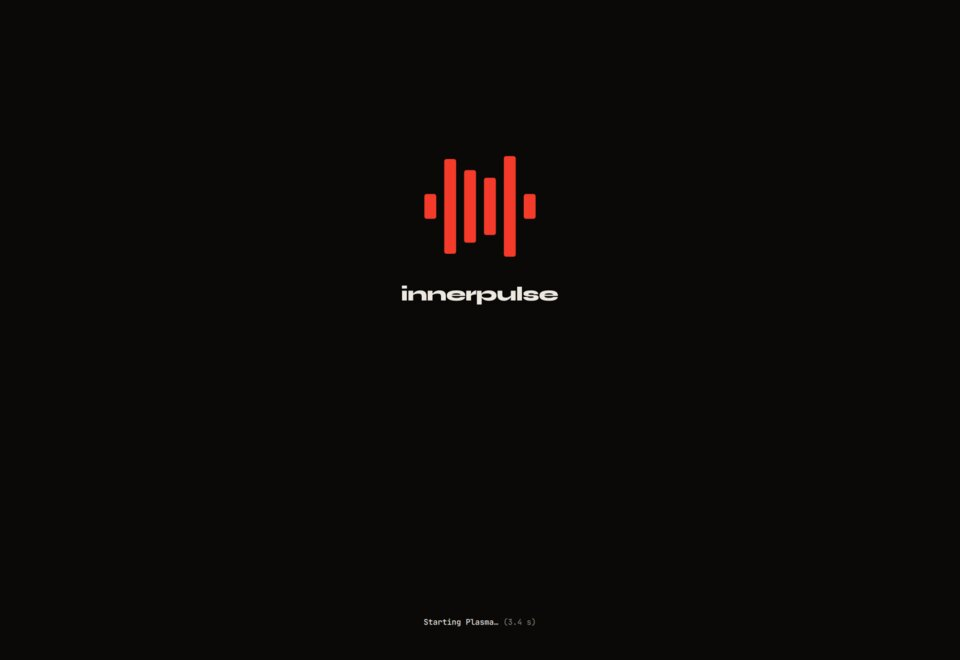
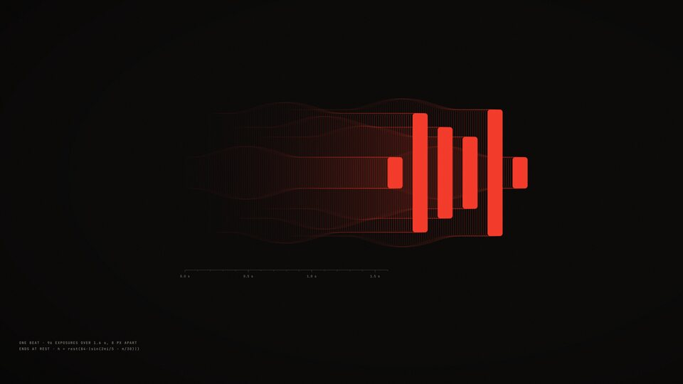
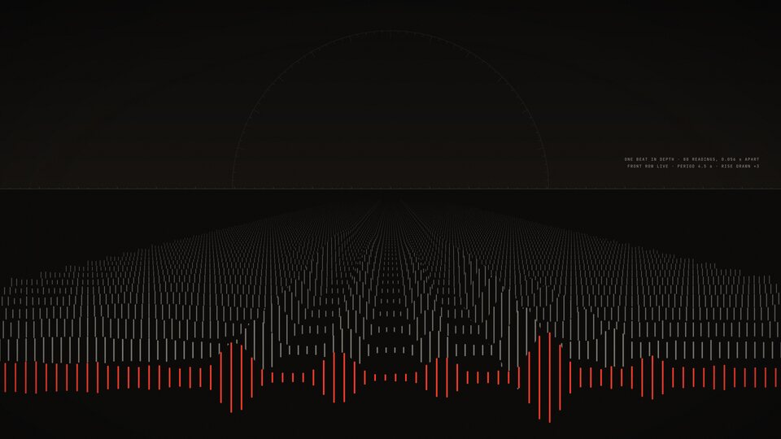
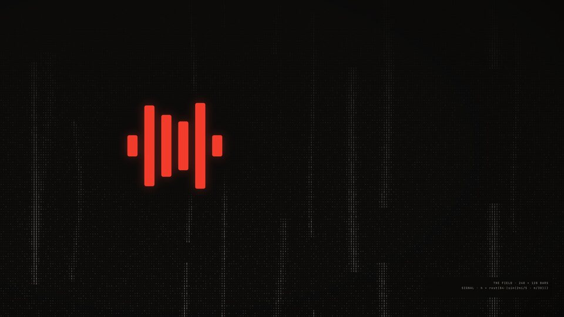
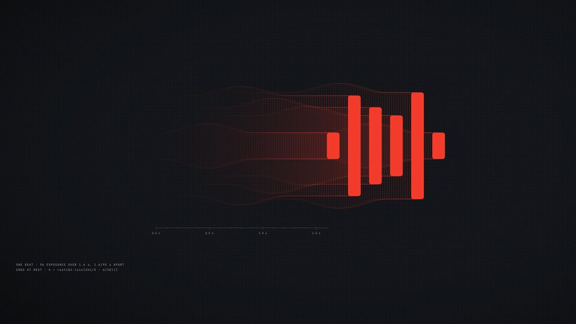

# innerpulse for KDE Plasma 6

A complete Plasma 6 desktop theme built on the [innerpulse](https://www.innerpulse.net) identity: an instrument
look with warm ink grounds, machined corners, hairlines, glass that's lit from above, and one ember signal. It ships
in three variants: **Ink** (the default), **Paper** and **Carbon**. Every color, frame and wallpaper is generated
from code, so nothing is redrawn by hand.



| Paper | Carbon |
|---|---|
|  |  |

These previews are illustrations drawn from the theme's own palette and geometry. The captures below are real.

| Apps in Carbon (Oxygen widget style) | Splash screen |
|---|---|
|  |  |

## What's in it

| Part | What it does |
|---|---|
| Color schemes `InnerpulseInk`, `InnerpulsePaper`, `InnerpulseCarbon` | Warm ink surfaces, paper, or carbon with brushed-steel text. Three text grays that clear WCAG AA. Selection is deep ember with white text (6.5:1), or gunmetal at 8.1:1 in Carbon. Focus rings are ember, links violet, and status colors mint, amber and soft red |
| Plasma themes `innerpulse`, `innerpulse-paper`, `innerpulse-carbon` | One per variant: colors follow the active scheme, while the glass and shadows are tuned to each ground. Panels have machined 4 px corners, a hairline and a faint graduated scale along the long edge. Popups carry one ember index tick at the top left, with a faint band under their headers. In menus, launchers and combo box lists the row index turns ember. The focused task gets an ember bar on the panel side; tasks that want attention get amber. The pager raises the current desktop in glass. Check boxes, radio buttons, switches, sliders, progress bars and scroll bars are drawn in steel rather than the selection color (Plasma still colors a stepped slider's tick marks itself); the busy indicator is a turning steel arc, never the mark |
| Glass | Surfaces are lit from above: a sheen through the top edge, a 1 px highlight lip and a faint shade at the foot. Panels and popups are frosted (about three quarters ground, blurred behind). Apps use Oxygen's widget style, recolored by the scheme, for raised glass buttons, tabs and progress bars. `--style breeze` gives flat widgets instead |
| Window decorations (Aurorae) | Glass title bar, hairline ring and soft shadow, with the ember index tick on the active window only. Buttons lift onto a glass tile on hover; close lifts onto the action red |
| Wallpapers | **Exposure** (default), **Horizon**, **Field**, **Ribbon**, and **Carbon**. All but Carbon come in ink and paper renditions, and Plasma picks the one that matches the scheme. Each caption states what's actually drawn |
| Splash screen | The mark draws itself in, then beats at a 2.4 s working tempo while Plasma starts, over a working line that shows the real elapsed time. It holds still when animations are off |
| Global themes | `innerpulse Ink`, `innerpulse Paper` and `innerpulse Carbon` in System Settings → Colors & Themes → Global Theme. None of them touches your panel layout |
| Konsole | Matching color schemes and profiles, with an ember block cursor |
| Fonts (optional) | Inter for the interface, JetBrains Mono for fixed-width. The installer fetches them, plus Instrument Sans and Syne, from google/fonts with `--fonts` |

### Wallpapers

| Exposure | Horizon |
|---|---|
|  |  |
| One beat of the mark photographed 96 times over 1.6 s, 8 px apart, resolving into the mark at rest | One beat in depth: 80 readings 0.056 s apart, receding to a horizon, with the rise drawn 3× (as its caption says). The front row is live |
| **Field** | **Carbon** |
|  |  |
| A frozen waterfall, 240 × 128 of the mark's bars, with the mark cleaned out of the noise | Exposure over a fine carbon-fiber weave |

## Install

You need Plasma 6 with Aurorae and the Oxygen widget style. On Kubuntu or Ubuntu that's
`sudo apt install kwin-style-aurorae kde-style-oxygen-qt6`.

### From a release (no build tools)

Download `kde-innerpulse-<version>.tar.gz` from the
[latest release](https://github.com/innerpulsenet/kde-innerpulse/releases/latest). It's already built.

```bash
tar -xzf kde-innerpulse-1.0.0.tar.gz && cd kde-innerpulse-1.0.0
```

```bash
./install.sh --fonts --apply ink
```

### From source

Building also needs Node 20 or newer, librsvg and ImageMagick:

```bash
sudo apt install librsvg2-bin imagemagick nodejs
```

```bash
git clone https://github.com/innerpulsenet/kde-innerpulse.git && cd kde-innerpulse
```

```bash
node src/build.mjs
```

```bash
./install.sh --fonts --apply ink
```

Everything installs under `~/.local/share` for the current user, so there's no sudo and nothing system-wide.

| Option | What it does |
|---|---|
| (none) | Copy the theme into place. Nothing on screen changes |
| `--apply ink`, `paper` or `carbon` | Switch the desktop to that variant. Your previous global theme, colors, decoration, splash, widget style, Konsole profile and fonts are saved first |
| `--style breeze` | With `--apply`: flat Breeze widgets instead of Oxygen's glass |
| `--fonts` | Fetch Inter, Instrument Sans, JetBrains Mono and Syne (SIL OFL) into `~/.local/share/fonts/innerpulse`. With them installed, `--apply` sets the interface and fixed-width fonts |
| `--launcher-icon` | Put the mark on the application launcher |
| `--restore` | Put back what was active before the first `--apply` |
| `--uninstall` | Restore, then remove every installed file. Fetched fonts are left in place |

## Known limitations

Both come from Oxygen's widget style, so a color scheme can't change them. `--style breeze` avoids both, at the
cost of the glass.

- In a list that doesn't have keyboard focus, Oxygen dims the selection to about 40% (roughly 1.3–1.5:1 against
  the list). The focused selection is full strength: 3.5:1 in Ink, 5.2:1 in Paper and 3.7:1 in Carbon.
- Oxygen doesn't fill the default button in a dialog, so "OK" and "Cancel" look alike. Breeze fills it.

## How it's built

```
brand/            the wordmark, ribbon and icon artwork
src/build.mjs     builds dist/, laid out like ~/.local/share
src/lib/
  mark.mjs        the mark's geometry and its one motion, the beat
  palette.mjs     every color in all three variants, chosen for contrast
  colors.mjs      KDE and Konsole color schemes
  svg.mjs         nine-slice frames drawn as plain paths (Qt SVG renders SVG Tiny, so no clip paths or filters)
  plasma.mjs      the Plasma themes: panel, popups, tooltips, widgets, tasks, list highlights, controls, glass
  aurorae.mjs     the window decorations and their buttons
  wallpaper.mjs, wallpaper-art.mjs   Field, Ribbon, Exposure, Horizon, Carbon
  preview.mjs     the global-theme previews
src/splash/       Splash.qml
install.sh        install, apply, restore, uninstall
```

To change a color, edit `src/lib/palette.mjs` and rebuild. `dist/` and `build/` are generated, so don't edit them.

## License

The code and theme files are MIT licensed (see [LICENSE](LICENSE)). The innerpulse name, mark, wordmark and
artwork are not covered by it. They ship with this theme and may be used as part of it, but not to brand anything
else. See [BRAND.md](BRAND.md), which also explains how to fork the theme with your own identity.
