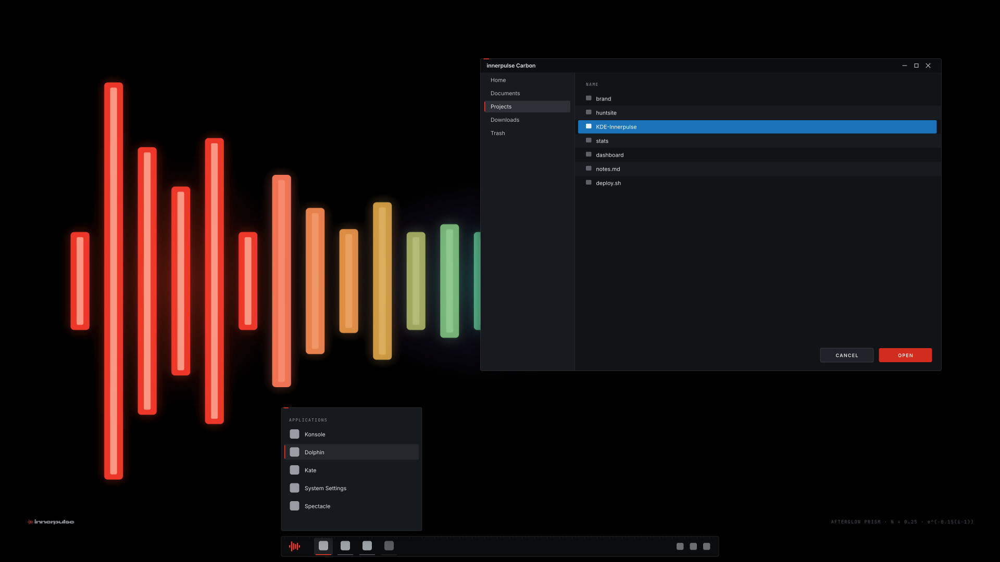
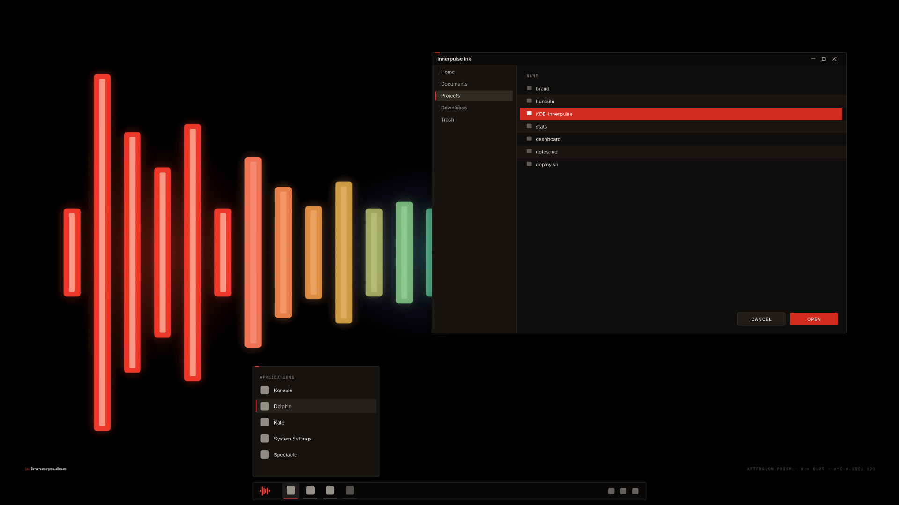
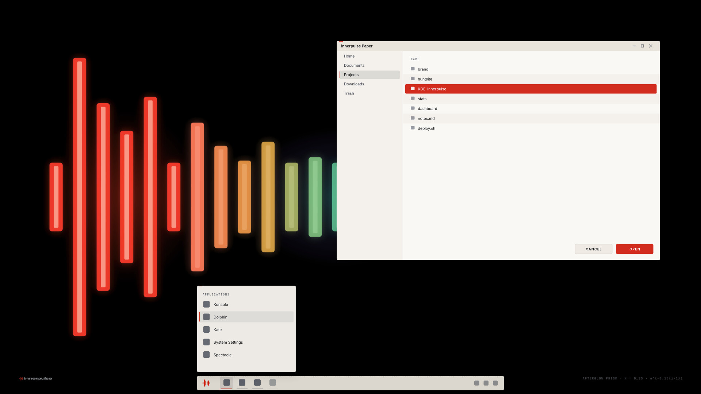
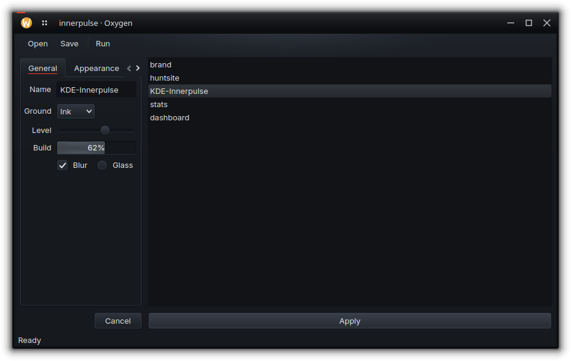
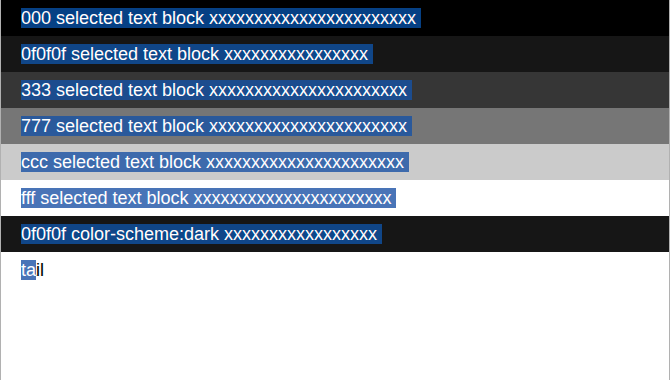
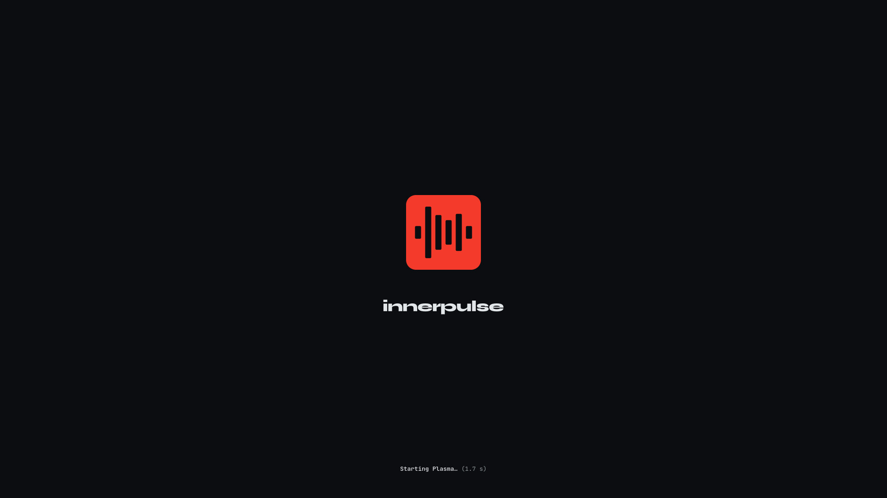
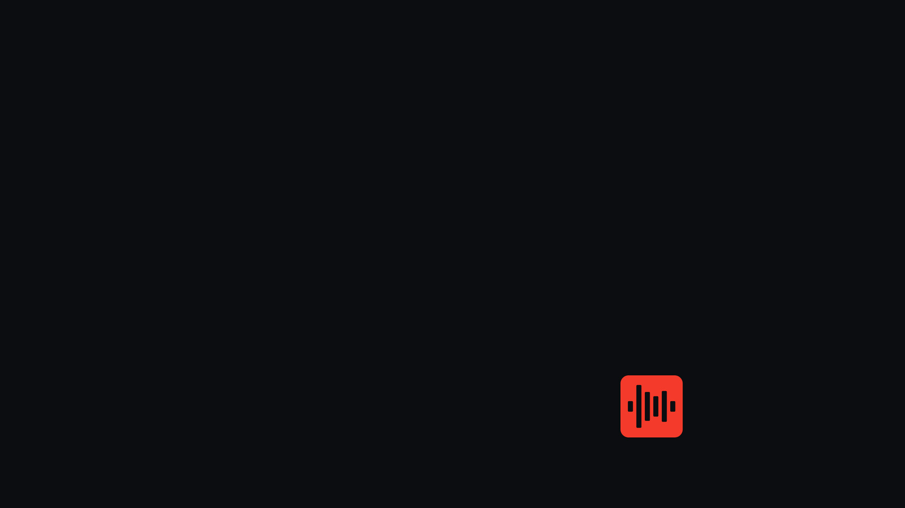
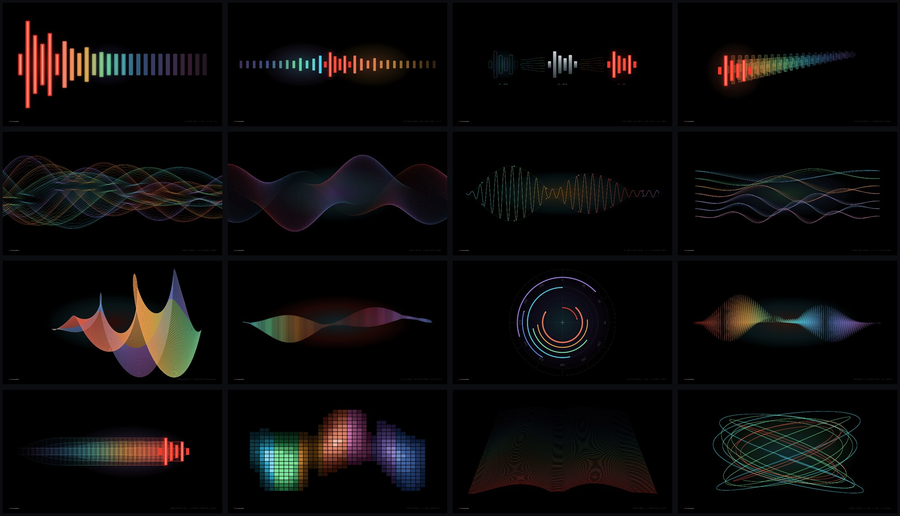

# innerpulse for KDE Plasma 6

A complete Plasma 6 desktop theme built on the [innerpulse](https://www.innerpulse.net) identity: an instrument
look with carbon grounds, brushed-steel text, machined corners, hairlines, glass that's lit from above, and one ember
signal. It ships in three variants: **Carbon** (the default, and the brand's own ground), **Ink**, the earlier warm
ground, and **Paper**. Every color and frame is generated from code; the wallpapers are the innerpulse OLED set.



| Ink | Paper |
|---|---|
|  |  |

These previews are illustrations drawn from the theme's own palette and geometry over the default wallpaper.

| Apps in Carbon (Oxygen widget style, captured) | Selected text in Chrome, Carbon (captured) |
|---|---|
|  |  |

| Splash screen (rendered from its QML) | Lock screen ground (the plate over it is live) |
|---|---|
|  |  |

## What's in it

| Part | What it does |
|---|---|
| Color schemes `InnerpulseInk`, `InnerpulsePaper`, `InnerpulseCarbon` | Warm ink surfaces, paper, or carbon with brushed-steel text. Three text grays that clear WCAG AA. Selection is the action red with white text (5.1:1), or blued steel at 5.0:1 in Carbon. Focus rings are ember, links violet, and status colors mint, amber and soft red. Every text, focus and hover pair in the schemes and Konsole sets is checked when the theme is built, and the build fails if one drops below WCAG AA (the text in an unfocused GTK entry selection, under Known limitations, is the documented exception) |
| Plasma themes `innerpulse`, `innerpulse-paper`, `innerpulse-carbon` | One per variant: colors follow the active scheme, while the glass and shadows are tuned to each ground. Panels have machined 4 px corners, a hairline and a faint graduated scale along the long edge. Popups carry one ember index tick at the top left, with a faint band under their headers. In menus, launchers and combo box lists the row index turns ember. The focused task gets an ember bar on the panel side; tasks that want attention get amber. The pager raises the current desktop in glass. Check boxes, radio buttons, switches, sliders, progress bars and scroll bars are drawn in steel rather than the selection color (Plasma still colors a stepped slider's tick marks itself); the busy indicator is a turning steel arc, never the mark |
| Glass | Surfaces are lit from above: a sheen through the top edge, a 1 px highlight lip and a faint shade at the foot. Panels and popups are frosted (about three quarters ground, blurred behind). Apps get the same material from the application style below |
| Application style `InnerpulseCarbon`, `InnerpulseInk`, `InnerpulsePaper` | Smoked glass for Qt apps, drawn by the Kvantum engine from one generated SVG per variant. A window's ground carries a soft glow from its top edge. Buttons, combo boxes and the selected tab are raised glass with a bright lip; fields, grooves and check boxes are wells. Hover is a soft glow in the hover color that fades in, keyboard focus is an ember ring (a focused view, such as a file list or an editor, takes a single ember hairline, so the live pane of a split view is marked without a red box round the window), and sliders and progress bars fill in steel. Without Kvantum installed, `--apply` uses Oxygen's glass recolored by the scheme (`--style oxygen`); `--style breeze` gives flat widgets |
| Icons `innerpulse`, `innerpulse Light` | Places, file types, drives and a few generic apps as smoked glass over the family tints, drawn at 16, 22, 32 and 64 px. Toolbar and action icons stay Breeze's, so a toolbar never mixes two line styles. The loading throbber is the six bars running the beat, in the text color. No icon imitates the mark |
| Cursors `innerpulse`, `innerpulse (still)` | Dark glass pointers with a bright rim, as scalable SVG for Plasma and as classic cursor files for other apps. Two shapes move: the wait cursor is the six bars retaking the reading every 2.4 s, and the progress cursor carries the bars beside the arrow with light passing through them every 1.2 s. The still theme holds the bars at rest; `--apply` picks it when animations are off |
| Window decorations (Aurorae) | Glass title bar, hairline ring and a soft shadow lit from above, with the ember index tick on the active window only. Buttons lift onto a glass tile on hover; close lifts onto the action red. Toggles that are on (all desktops, keep above or below, shade) sit sunken with a bar under the glyph. Each variant also comes as `innerpulse … (frosted title bar)`, whose active title bar is translucent and blurred behind |
| Wallpapers | The OLED set: sixteen images in four sets (Afterglow Prism, Phosphor Harmonics, Chromatic Helix, Pulse Chronograph) on a true black ground, each in 2560 × 1440, 3440 × 1440, 3840 × 2160 and 5120 × 2160, so 16:9 and 21:9 screens both get a native rendition. Each image's footer, the wordmark at the left and its caption at the right, is lifted clear of a bottom panel when the theme is built (46 px at 1440 and 69 at 2160; Chromatic Ribbon's stops at 16 and 26 under its lowest lobe, which still clears Plasma's default floating panel). **Afterglow Prism** is the default for every variant. A quiet ground, the same black with nothing on it, is there for a second screen (`--quiet-second-screen`) |
| The mark | The plate: the beat cut out of a solid ember tile, as the brand now draws it. Where the viewer rests or waits (the splash, the lock screen, the logout prompt) it is live: its slots open once, then a pulse of light passes through them. The plate itself never moves. In a panel, where it would be under 32 px, the mark is the six bars alone. The bars themselves move in two places only: the busy cursors and the loading throbber |
| Splash screen | The plate on carbon, centered, with the wordmark under it. Its slots open, then a pulse of light passes through them every 2.4 s while Plasma starts, over a working line that shows the real elapsed time. When start-up is done the pulse in flight finishes and the screen fades. It holds still when animations are off, and the timer then counts whole seconds |
| Boot screen `innerpulse` | A Plymouth theme: the splash's picture from the first frame the kernel can draw, and again on the way down. The plate on carbon with the wordmark under it; its slots open once, then a pulse of light passes through them every 2.4 s. The line at the foot says which way the machine is going and shows whatever the system sends (a disk check, a passphrase prompt in a glass field). No progress bar and no timer: Plymouth's progress is an estimate from the last boot. Installed system-wide by `--boot` |
| Lock screen | The variant's ground with the plate low and to the right, so the clock, avatar, password field and footer sit on clear ground, shown by a small wallpaper plugin (`net.innerpulse.lock`) that draws the live plate over the resting one, a pulse of light every 4.5 s. It holds still when animations are off |
| Logout prompt | Plasma's own prompt, loaded as it is, on the carbon ground instead of black, with the countdown in JetBrains Mono and the live plate above the avatar at the 4.5 s ambient tempo |
| Motion | Windows open and close on a shorter, shallower scale (160 ms from 94 %, instead of 200 ms from 80 %). Launch feedback is static: the starting app's icon sits still by the pointer instead of bouncing. Oxygen's widget animations follow Plasma's animation speed (see below) |
| Global themes | `innerpulse Carbon`, `innerpulse Ink` and `innerpulse Paper` in System Settings → Colors & Themes → Global Theme. None of them touches your panel layout |
| Konsole | Matching color schemes and profiles, with an ember block cursor |
| Fonts (optional) | Inter for the interface, JetBrains Mono for fixed-width. The installer fetches them, plus Instrument Sans and Syne, from google/fonts with `--fonts` |

### Wallpapers



One row per set, left to right: **Afterglow Prism** (Prism, Diverging, Stages, Monolith), **Phosphor Harmonics**
(Spectrum, Caustics, RF Envelope, Overtones), **Chromatic Helix** (Chromatic Ribbon, Helix Bifrost, Celestial
Astrolabe, Torsion Prism) and **Pulse Chronograph** (Chronograph Wake, Spectral Waterfall, Retake Horizon, Instrument
Scope). Pick one in System Settings → Wallpaper; each appears as `innerpulse <name>`. They are drawn for dark rooms
and OLED panels, so Paper keeps the same black wallpapers.

## Install

You need Plasma 6 with Aurorae, and Kvantum for the application style (Oxygen is the fallback without it). On
Kubuntu or Ubuntu that's `sudo apt install kwin-style-aurorae qt6-style-kvantum kde-style-oxygen-qt6`.

### From a release (no build tools)

Download `kde-innerpulse-<version>.tar.gz` from the
[latest release](https://github.com/innerpulsenet/kde-innerpulse/releases/latest). It's already built.

```bash
tar -xzf kde-innerpulse-1.0.0.tar.gz && cd kde-innerpulse-1.0.0
```

```bash
./install.sh --fonts --apply
```

### From source

Building also needs Node 20 or newer, librsvg and ImageMagick:

```bash
sudo apt install librsvg2-bin imagemagick nodejs
```

```bash
git clone https://github.com/innerpulsenet/kde-innerpulse.git && cd kde-innerpulse
```

```bash
node src/build.mjs
```

```bash
./install.sh --fonts --apply
```

Everything installs under `~/.local/share` for the current user (the application style's three themes go to
`~/.config/Kvantum`, where Kvantum reads them), so there's no sudo and nothing system-wide.

| Option | What it does |
|---|---|
| (none) | Copy the theme into place. Nothing on screen changes |
| `--apply`, or `--apply carbon`, `ink` or `paper` | Switch the desktop to that variant (Carbon when none is named). Your previous global theme, colors, accent color, decoration, splash, widget style, Kvantum theme, cursors, icons, Konsole profile, fonts, lock screen, window open and close animation, launch feedback and Oxygen animation settings are saved first. A custom or wallpaper accent is switched off, since it would retint the selection |
| `--style glass`, `oxygen` or `breeze` | With `--apply`: the widget style. `glass` is the theme's own smoked glass (needs Kvantum) and the default when Kvantum is installed; `oxygen` is Oxygen's glass recolored, the default without it; `breeze` is flat |
| `--frosted-titlebar` | With `--apply`: the frosted window decoration, whose active title bar is translucent and blurred behind. The default is opaque |
| `--quiet-second-screen` | With `--apply`: on more than one screen, the wallpaper stays on the primary screen and every other screen gets its black with nothing on it. By default every screen shows the same wallpaper |
| `--fonts` | Fetch Inter, Instrument Sans, JetBrains Mono and Syne (SIL OFL) into `~/.local/share/fonts/innerpulse`. With them installed, `--apply` sets the interface and fixed-width fonts |
| `--launcher-icon` | Put the mark on the application launcher: the six bars alone, as the brand draws the mark under 32 px, pixel-snapped at 22, 24 and 32 px so it stays sharp at panel size. The app icon, `innerpulse-app`, is the plate |
| `--boot` | Install the boot screen and select it. This is the one system-wide part, so it asks for sudo: it writes `/usr/share/plymouth/themes/innerpulse`, selects it (`update-alternatives`, or `plymouth-set-default-theme` where that is the tool) and rebuilds the initramfs. The selection it replaces is noted beside the theme |
| `--boot-restore` | Select the previous boot screen again, remove ours and rebuild the initramfs (sudo). `--uninstall` does not touch the boot screen |
| `--restore` | Put back what was active before the first `--apply`, the lock screen included. The desktop wallpaper is left as it is |
| `--uninstall` | Restore, then remove every installed file. Each screen still showing an innerpulse wallpaper is switched to the previous global theme's wallpaper (or Plasma's Next); screens showing your own wallpaper keep it. Fetched fonts are left in place |

### Motion settings

- **Animation speed and Oxygen.** Oxygen doesn't read Plasma's Animation speed setting, so `--apply` copies it
  into Oxygen's own settings: at Instant, Oxygen's animations are off. It's read once, so after you change the
  speed, run `--apply` again and restart open apps. KWin's effects follow the setting on their own. The splash,
  lock screen and logout prompt hold the plate still, slots open and dark, when the speed is Instant; at any other
  speed they keep the brand's 4.5 s and 2.4 s pulses.
- **Animation speed, Kvantum and the cursors.** Kvantum and cursor themes don't read the setting either. At
  Instant, `install.sh` turns off the glass style's state fades in its installed themes, and `--apply` picks the
  still cursor theme. Both are read once: after changing the speed, run `./install.sh --apply` again.
- **A still mark on the lock screen.** While the password prompt is up, the lock screen blurs its wallpaper, which
  turns the pulse of light into a soft glow. To keep it still, turn off "A pulse of light every 4.5 s while locked" in
  System Settings → Screen Locking → Appearance, or run
  `kwriteconfig6 --file kscreenlockerrc --group Greeter --group Wallpaper --group net.innerpulse.lock --group General --key BeatOnLock false`.

## Known limitations

In the smoked-glass style (Kvantum):

- The global themes in System Settings still name Oxygen as their widget style, because a global theme cannot
  choose Kvantum's theme. `install.sh --apply` is what switches to the glass style.
- The keyboard-focus ring on a button is drawn just inside the button rather than as a glow around it: Kvantum
  draws focus inside a control's content area. Fields get the full ember glow.
- Kvantum sets an app's colors from its own theme, so the glass style follows the variant you applied, not a
  color scheme picked by hand later. Run `--apply` with the variant to switch both.
- GTK apps are not drawn by Kvantum; they keep Breeze GTK with the scheme's colors.

The cursors:

- Plasma lists cursor themes through libXcursor, and many builds of it search `~/.icons` but not
  `~/.local/share/icons`. `install.sh` therefore links both cursor themes into `~/.icons`; `--uninstall` removes
  the links.

The boot screen:

- A passphrase prompt was checked in the Plymouth engine, but the bullets that appear as you type were not:
  the test window takes no synthetic keys. If you unlock a disk at boot and they look wrong, say so.
- Text needs Plymouth's label plugin and a font in the initramfs. It asks for JetBrains Mono and falls back to
  whatever monospace face the initramfs carries.

The next two come from Oxygen's widget style (`--style oxygen`), so a color scheme can't change them.

- In a list that doesn't have keyboard focus, Oxygen dims the selection to about 40% (roughly 1.5–1.9:1 against
  the list). The focused selection is full strength: 3.8:1 in Ink, 4.8:1 in Paper and 3.7:1 in Carbon. The
  color scheme itself doesn't dim an unfocused window's selection.
- Oxygen doesn't fill the default button in a dialog, so "OK" and "Cancel" look alike. Breeze fills it.
- In GTK apps, a window without focus keeps the full selection color (3.8:1 against the list in Ink, 4.8:1 in
  Paper, 3.7:1 in Carbon), but Breeze GTK draws text selected in an entry in the view's background color rather
  than white. That text is 3.8:1 in Ink and 3.7:1 in Carbon, readable but under the 4.5:1 the rest of the theme
  holds (Paper's is 4.8:1). Breeze GTK hard-codes that choice, so the scheme can't change it.

These come from KWin's Aurorae engine, which draws the window decorations:

- Aurorae ignores the animation-speed setting, so `install.sh` scales the decorations' fades by the speed set at
  that moment (instant turns them off), on every install or update. If you change the speed later, run
  `./install.sh` again.
- A maximized window has no index tick. Aurorae stretches a maximized title bar from one slice, and a tick can't
  survive the stretch.
- A toggle that is on shows no hover, and the sunken look flashes while you hold the mouse on one that is off.
  Aurorae uses one state for both pressed and on.

## How it's built

```
brand/            the wordmark, the small mark and the app icon (the plate), from the brand kit
wallpapers/       the OLED set, one folder per wallpaper, a JPEG per size (the build lifts each footer clear of the panel)
src/build.mjs     builds dist/, laid out like ~/.local/share
src/lib/
  mark.mjs        the mark's geometry: the beat, the plate and its pulse of light, and the bars in motion
  palette.mjs     every color in all three variants, chosen for contrast
  colors.mjs      KDE and Konsole color schemes
  svg.mjs         nine-slice frames drawn as plain paths (Qt SVG renders SVG Tiny, so no clip paths or filters)
  plasma.mjs      the Plasma themes: panel, popups, tooltips, widgets, tasks, list highlights, controls, glass
  aurorae.mjs     the window decorations and their buttons
  kvantum.mjs     the application style: Kvantum's SVG and configuration for each variant
  icons.mjs       the icon themes: places, file types, devices, generic apps, the throbber
  cursors.mjs     the cursor themes, as SVG cursors and as classic cursor files
  plymouth.mjs    the boot screen: the Plymouth script, and the plates and lamps it shows
  wallpaper.mjs   the wallpaper list, the quiet ground and the lock screen's ground
  preview.mjs     the global-theme and splash previews
src/splash/       Splash.qml
src/lock/         the lock screen's wallpaper plugin
src/logout/       the logout prompt (a wrapper that loads Plasma's own)
src/qml/          AmbientMark.qml, the live plate, shared by the splash, the lock screen and the logout prompt
install.sh        install, apply, restore, uninstall
```

To change a color, edit `src/lib/palette.mjs` and rebuild. The QML screens take the mark's geometry, tempos and
colors from the same modules at build time (values tagged `/*@KEY@*/`). `dist/` and `build/` are generated, so don't edit them.

## License

The code and theme files are MIT licensed (see [LICENSE](LICENSE)). The innerpulse name, mark, wordmark,
wallpapers and other artwork are not covered by it. They ship with this theme and may be used as part of it, but not to brand anything
else. See [BRAND.md](BRAND.md), which also explains how to fork the theme with your own identity.
